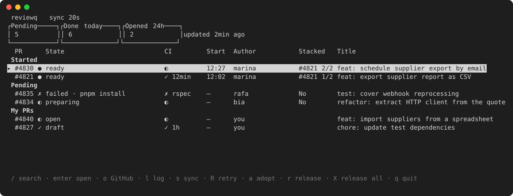

# herdr-reviewq



A macOS daemon that turns your GitHub review queue into ready-to-use [herdr](https://herdr.dev) workspaces.

When someone requests your review on a pull request, reviewq creates a git worktree for the PR, opens it as a herdr workspace and runs the repo's setup commands (`mise install`, `bundle install`, `pnpm install`, and so on). You get a notification when the worktree is ready. Once the PR leaves your queue (you reviewed it, or it was closed or merged), reviewq waits for a grace period and then removes the worktree, but only if you never touched it.

A herdr plugin adds a panel that shows your pending reviews, the state of each worktree, the CI of each PR and how many reviews you did today. It also lists the pull requests you opened and how many you opened in the last 24 hours.

## How it works

- **What it tracks.** Pull requests where your review was requested directly. It ignores PRs from forks and requests made only to a team you belong to.
- **Polling.** The daemon checks GitHub through the `gh` CLI every `poll_interval_secs` (60 s by default).
- **New request.** It creates a worktree on the PR's branch, opens a herdr workspace for it and runs the setup steps. Each step has its own timeout, and the output is saved to a redacted per-PR log.
- **New commits.** When the PR gets new commits, it updates the worktree with `git reset --keep`, which refuses to overwrite local changes.
- **PR leaves your queue.** It waits `remove_grace_secs` (15 min by default), then removes the worktree and the local branch it created. If the review is requested again later, the worktree comes back.
- **Work started.** When a Claude or Codex session opens inside a review worktree, reviewq records the time and the agent. herdr doesn't report when an agent started, so the time is the first check (every `poll_interval_secs`) that saw it. This is informational only: it doesn't protect the worktree from removal.
- **CI, stacks and your PRs.** Every `poll_interval_secs` reviewq also reads the CI status of each tracked PR, the open PRs of each repo (number and branches, to detect stacked PRs), your open PRs in the configured repos and how many PRs you created in the last 24 hours. This runs after the review sync, in a separate step with a 30-second budget, and it never changes worktrees: if GitHub or herdr fail here, the review queue is unaffected. CI is always the status of the PR's latest commit on GitHub, which may differ from what's checked out locally.
- **Your own work is safe.** If you commit, switch branches or edit files in a worktree, reviewq leaves it in place and shows an alert in `status`. Worktrees you moved to another branch are marked as *adopted*. You can also adopt a worktree yourself before you start working in it. Adopted worktrees are never removed automatically.

## Requirements

- macOS (the daemon runs as a launchd LaunchAgent)
- [herdr](https://herdr.dev) 0.9.3 or newer, or the Herdr desktop app (see [Herdr desktop app](#herdr-desktop-app))
- The [GitHub CLI](https://cli.github.com), authenticated: `gh auth login`, then `gh auth setup-git`
- Rust and cargo, only to build from source
- A local clone of every repo you review
- Whatever your setup commands need, for example [mise](https://mise.jdx.dev)

## Install

1. Install the plugin. The install downloads the binary for your Mac from the GitHub release and puts it at `~/.local/bin/herdr-reviewq`:

   ```sh
   herdr plugin install cirdes/herdr-reviewq
   ```

2. Create the config. The install leaves the example next to where the config goes:

   ```sh
   cp ~/.config/herdr-reviewq/config.example.toml ~/.config/herdr-reviewq/config.toml
   ```

   In `[[repos]]`, set each repo's `name` (`owner/repo`), the `path` to your local clone and its `setup` commands.

   In `disposable_ignored`, list the ignored paths your setup creates (such as `node_modules`, `vendor/bundle`, or `.husky/_` when the install runs husky). These are the only ignored files reviewq may delete along with a worktree.

   Unknown config keys are an error.

3. Start the daemon. This registers and starts the LaunchAgent:

   ```sh
   ~/.local/bin/herdr-reviewq service install
   ```

To update, reinstall the plugin. With the daemon installed, the install restarts it on the new binary:

```sh
herdr plugin uninstall cirdes.reviewq && herdr plugin install cirdes/herdr-reviewq
```

A panel that is already open keeps running the old binary until you close its pane and open the panel again.

### From source

To run your own build, create the config as in step 2 (copy `config.example.toml` from the clone), then:

```sh
cargo build --release
./target/release/herdr-reviewq service install
herdr plugin link /path/to/herdr-reviewq
```

`service install` copies the binary to `~/.local/bin/herdr-reviewq`, which the plugin runs. `plugin link` skips the download and points at your working tree. If you check out a branch that lacks `herdr-plugin.toml` or `bin/herdr-reviewq`, the panel and actions break; run `herdr plugin link` again after switching back. To update, pull, build and run `service install` again.

### Releasing

Releases are automatic. Every merge to `main` that changes the binary or the plugin (`src/`, `Cargo.*`, `bin/`, `herdr/`, `herdr-app/`, `herdr-plugin.toml`, `config.example.toml`) runs the release workflow, which:

1. bumps the patch version in `Cargo.toml`, `Cargo.lock` and `herdr-plugin.toml` and commits it to `main` as `chore: release vX.Y.Z`;
2. tags that commit;
3. builds both Mac binaries, attaches them with their checksums and publishes the release once both are up.

Merges that only touch docs don't release. For a minor or major release, set the new version in `Cargo.toml` and `herdr-plugin.toml` in the PR (a test keeps them equal): when that version has no tag yet, the workflow tags it as is instead of bumping. Pull after a release, since the bump commit lands on `main`.

The install downloads the release whose tag matches the manifest version. Pushing a `v*` tag by hand still publishes that tag, as long as it matches the manifest.

## The panel

The daemon opens a `reviewq` workspace with the panel every time it starts. herdr actions are available for keyboard shortcuts:

| Action | Command | What it does |
|---|---|---|
| `open` | `herdr-reviewq ui open` | Opens the panel, or recreates it if you closed it |
| `first-ready` | `herdr-reviewq focus first-ready` | Jumps to the oldest PR that is ready for review |
| `sync-now` | `herdr-reviewq request sync` | Checks GitHub right away |
| `release-all` | `herdr-reviewq request release-all` | Releases every adopted worktree; the ones with local work are kept and reported |

The list has these sections, in order: **Started** (pending reviews where an agent was opened, most recent first), **Pending**, **My PRs** (your open PRs, newest first), **Adopted**, **No sync** and **Leaving**. The counters show pending reviews, reviews done today and PRs you opened in the last 24 hours (`?` means some repo is missing or out of date).

### Columns

| Column | What it shows |
|---|---|
| `PR` | The PR number (`#123`), or `owner/repo#123` when more than one repo is configured. |
| icon | The worktree: `●` ready, `◐` being created or set up, `✗` setup failed, `⊘` blocked, `○` being removed, `◆` adopted by you. In **My PRs** it is the CI icon instead. |
| `State` | The worktree state in words (`ready`, `preparing`, `failed · <step>`, `blocked · <reason>`, `removing`), with extra detail where it matters: `leaves in Nmin` for a PR leaving your queue, `yours · <reason>` for an adopted worktree, `GitHub not synced` when the last sync for that repo failed. In **My PRs**: `open` or `draft`. |
| `CI` | The CI of the PR's latest commit on GitHub: `◐` running, `✓` passed and how long ago, `✗` failed and the first failing check, `?` not known for the current commit, empty before the first collection. When the check name does not fit the column, words are dropped from the end so the icon of the check survives (`✗ 🌐 System` becomes `✗ 🌐`). |
| `Start` | When you started working on it: the first time an agent (Claude or Codex) was seen open in the PR's worktree, as `HH:MM` today or `Mon DD` (such as `Nov 18`) on other days. `–` until that happens. It is not the PR's age. |
| `Author` | The PR author. `you` in **My PRs**. Hidden when the pane is too narrow. |
| `Stacked` | Whether the PR is stacked: `No`, or `#<bottom PR> i/n` for its position in the stack. A PR is stacked when its base is the branch of another open PR in the repo. The stack is built from all open PRs of the repo, so the numbering stays the same when a PR in the middle or at the bottom leaves your queue; it only changes when a PR is closed or merged. Before the first collection, only the PRs in the list are used, and the cell is empty in **My PRs**. Hidden before `Author` when the pane is too narrow. |
| `Title` | The PR title, with whatever width is left. |

Columns are laid out by terminal cells, so an emoji in a check name does not shift the columns to its right.

Quitting the panel (`q`) closes its pane, because the pane ends with its command. The panel always runs the binary installed in `~/.local/bin`. Panel start, exit (key or signal) and errors are logged to `~/.local/state/herdr-reviewq/logs/tui.log`.

### Keys

| Key | Action |
|---|---|
| `↑` `↓` / `k` `j` | Move the selection |
| `/` | Search: filter the list as you type (see [Search](#search)) |
| `enter` | Open the PR's workspace (recreated if it was closed). On your own PRs, focus the worktree where the PR's branch is checked out; if there is none, create one at `worktrees_dir/<owner>/<repo>/mine-pr-<n>` and open it in herdr |
| `o` | Open the PR in the browser on the daemon's machine, and copy the URL through OSC 52 (handy over a remote session) |
| `l` | Open the PR's setup log |
| `s` | Sync now |
| `R` | Retry (managed PRs only, when setup failed or the worktree is missing) |
| `a` | Adopt the worktree (asks for `y`/`n`) |
| `r` | Release an adopted worktree (asks for `y`/`n`) |
| `X` | Release all adopted worktrees at once (asks for `y`/`n`). Worktrees with uncommitted work, or unpushed work on a PR that is still open, are kept, and the result line lists them |
| `q` / `esc` / `ctrl+c` | Quit. With a search active, `esc` clears it instead |

On your own PRs (**My PRs**) only `enter` and `o` do something; `l`, `R`, `a` and `r` apply to review worktrees. A worktree created by `enter` on your own PR is yours: reviewq doesn't run the repo's setup in it, doesn't track it and never removes it. If the branch already exists locally, it is checked out as it is (never reset to `origin`); otherwise it starts at `origin/<branch>` with the upstream set. The branch comes from the open PRs reviewq collects for stacks, so `enter` only works after the first collection.

### Search

`/` filters the list as you type. Only matching rows stay, still grouped in their sections, and the footer shows how many match (`/eng-4321▏ (2 of 23)`).

- **What it looks at:** the PR number (`123` or `#123`), repo, author, title and branch. The branch is where a Linear issue usually lives (`alice-eng-4321-fix`), so `eng-4321` finds the PR even if the title doesn't mention it. For **My PRs** the branch comes from the open PRs reviewq collects for stacks, so it is unknown until the first collection.
- **How it matches:** fuzzy, ignoring case and accents. A word matches a field when its letters appear there in order, gaps allowed, so `crimp` finds "Correct importation" and `eng4321` finds `alice-eng-4321-fix`. The letters must all come from the same field: `101alice` doesn't join the number and the author. Several words must all match: `alice tela`.
- **Order:** inside each section, the best matches come first. An exact piece of text beats scattered letters, and matches at the start of a word or with letters next to each other score more. Ties keep the usual order. A row waiting for `y`/`n` stays at the top of its section even if it doesn't match.
- **While typing,** every letter goes into the search (`q`, `s`, `a`... don't trigger actions). `↑` `↓` move the selection, `backspace` deletes, `ctrl+u` clears the text, `enter` keeps the filter and gives the keys back, `esc` clears it. Other `ctrl`/`alt` combinations are ignored. A result that arrives while you type (a sync, say) shows on the top line.
- **With the filter kept,** the top line shows `search "<text>": n of m`. The filter survives list refreshes; `/` edits it and `esc` clears it. The counters (Pending, Done today, Opened 24h) ignore the filter.

## Command line

| Command | What it does |
|---|---|
| `herdr-reviewq status` | Pending, ready and adopted PRs with CI, work start and stack position, today's count, PRs opened in the last 24 hours, your open PRs and alerts |
| `herdr-reviewq request sync` | Check GitHub now |
| `herdr-reviewq request retry --pr owner/repo#123` | Rerun a failed setup, or recreate a missing worktree (managed worktrees only) |
| `herdr-reviewq request adopt --pr owner/repo#123` | Mark a worktree as yours before you work in it |
| `herdr-reviewq request release --pr owner/repo#123` | Hand an adopted worktree back. Only works if it is clean and everything is pushed. Once the PR is merged or closed, commits that never reached origin don't block it: they stay in `refs/reviewq/backup/pr-<n>/` for 14 days and the result says so. |
| `herdr-reviewq request release-all` | Hand back every adopted worktree. The ones that are not clean or not pushed are kept and listed in the result. |
| `herdr-reviewq service restart` | Restart the daemon, for example after editing the config |
| `herdr-reviewq service uninstall` | Remove the LaunchAgent |

Logs live in `~/.local/state/herdr-reviewq/`: `daemon.log`, plus one redacted setup log per PR under `logs/`.

## Herdr desktop app

reviewq also runs on the Herdr desktop app (`herdr-app`, with herdr-core `hc`). By default (`backend = "auto"`) it works out which one you use:

- **The panel and the actions** (`ui open`, `focus first-ready`) look at where they run: `HERDR_ENV=1` means a herdr pane, `HC_TERMINAL_ID` means a herdr-app terminal.
- **The daemon** runs under launchd, without that environment, so at start it checks, in order: a desktop window listening to this machine (the `reviewq-bridge` mod signalled in the last 2 minutes), then a herdr server that answers, then `herdr-app` on the `PATH`. Both can run on the same machine, so the listening window wins over a herdr server that is merely up. If none of them is there yet (right after login, say), the daemon waits and checks again every 10 seconds. `daemon.log` says which one it picked and why.

The daemon keeps its choice until it restarts, because the workspace ids it stores belong to one backend. If you switch between the two, restart it with `herdr-reviewq service restart`. To skip the detection, set the backend in the config and restart the daemon:

```toml
backend = "herdr-app" # or "herdr"
```

A backend set in the config wins everywhere, including in the panel.

Nothing else changes: the daemon, the panel, the keys and the command line are the same. What differs is how each step reaches Herdr:

- **Workspaces are spaces, created by herdr-core.** The daemon starts a shell in the worktree with `hc run --label herdr.space=<id>`, so worktrees are prepared even with the window closed; the space shows up when it opens. The id is derived from the worktree path. With the window open, the space is named `#<n> <title>`; otherwise it keeps the folder name.
- **The panel is the same TUI**, in a `reviewq` space: `herdr-reviewq ui open` (and the daemon at start) runs `herdr-reviewq tui` there. Bind it to a key in `~/.config/herdr-app/keys.json` if you like; `l` opens the setup log in a split below the panel.
- **Agents** (Claude Code, Codex) are read from `hc ls` and `hc get`.
- **Notifications** are macOS notifications (`osascript`): the desktop app has no notification command.
- **Removing a worktree** closes its space and ends its terminals, then runs `git worktree remove` without `--force`, under the same pristine rules.

The herdr plugin (`herdr-plugin.toml`) is not used by the desktop app; there is no need to link it.

### Window on another machine

The daemon can run on a machine that the window only connects to, such as a Mac mini added with `hc machine add` from your laptop. That machine has no `herdr-app`, and it can't reach the window: the connection goes from the window to it. reviewq notices on its own: with the desktop app as backend (set or detected) and no `herdr-app` in its `PATH`, it treats the window as remote. To force one mode, set `window = "local"` or `window = "remote"`.

With a remote window, reviewq only talks to the herdr-core of its own machine:

- **Listing, naming and closing spaces** edit the `herdr-app` doc in that core, where the window keeps the machine's spaces. A write only lands if nobody wrote in between; otherwise reviewq reads again and retries.
- **Focusing a PR** (`enter` in the panel, `focus first-ready`) writes `{ space, at }` to the `reviewq-focus` doc. The `reviewq-bridge` mod, installed in the window, reads that doc on every connected machine once a second and shows the space. A request older than 30 seconds, or made before the mod started, is ignored, so an old one never steals the focus.
- **The panel's focus is not given back** after it opens: the doc doesn't say which space is shown.

Install the mod on the computer with the window, copying it from the machine that has the repo (here `macmini`; see `hc machine ls`):

```sh
M=~/.config/herdr-app/mods/reviewq-bridge; mkdir -p "$M"
for f in main.js mod.json; do
  hc exec --on macmini cat Workspaces/herdr-reviewq/herdr-app/mods/reviewq-bridge/$f > "$M/$f"
done
herdr-app check "$M"
```

Herdr docks a new mod into the layout on screen, but the shipped layouts (`main` and the others) are read-only, so on one of them the mod never starts. Clone the layout (this also switches to the clone) and add the bar at the end of its `work` column, in `~/.config/herdr-app/layouts/main-reviewq.json`:

```sh
herdr-app do layout.clone '{"name":"main","as":"main-reviewq"}'
```

```json
{ "id": "reviewq-bridge", "type": "block", "size": { "px": 22 }, "content": { "mod": "reviewq-bridge" } }
```

`herdr-app status` should list the mod with no errors.

The bar shows the machines it listens to and the last space it focused, or the error when a machine can't be read. Every 30 seconds it also writes `{ at }` to the `reviewq-bridge` doc on each machine, so reviewq knows a window is listening:

- If no window ever wrote it, the daemon raises an alert (checked every 5 minutes, once until it's fixed).
- If a focus request finds no recent signal, the panel says so: the request is saved, but the window is closed or doesn't have the mod.

## Safety guarantees

- **Only pristine worktrees are removed, and only after the grace period.** Pristine means:
  - same branch and commit that reviewq checked out;
  - no tracked changes and no new files;
  - no ignored files outside `disposable_ignored`.
- **No destructive git commands.** reviewq never runs `reset --hard`, `clean` or `--force`. Updates use `reset --keep`.
- **Local branches are deleted only when reviewq created them**, they still point at reviewq's commit and no other worktree has them checked out.
- **Backups before changes.** Before any reset or removal, the previous commit is saved under `refs/reviewq/backup/pr-<n>/<timestamp>` and kept for 14 days.
- **Failures fail safe.** A failed GitHub query never removes anything, and a failure to save state stops the cycle.
- **Diffs match GitHub's.** reviewq fetches the PR's base branch (`baseRefName`; for a stacked PR, the branch of the PR below it) into `origin/<base>` when it creates the worktree, on every push by the author and whenever GitHub retargets the PR. Local branches, like the clone's `main`, are never touched, so compare against `origin/<base>`, not `main`.
- **reviewr opens on the right base.** In each worktree, the base is stored as the reviewr base pick (plugin `persiyanov.reviewr`, ref `refs/worktree/reviewr/base-pick`). A base you pick yourself with `B` is never overwritten.
